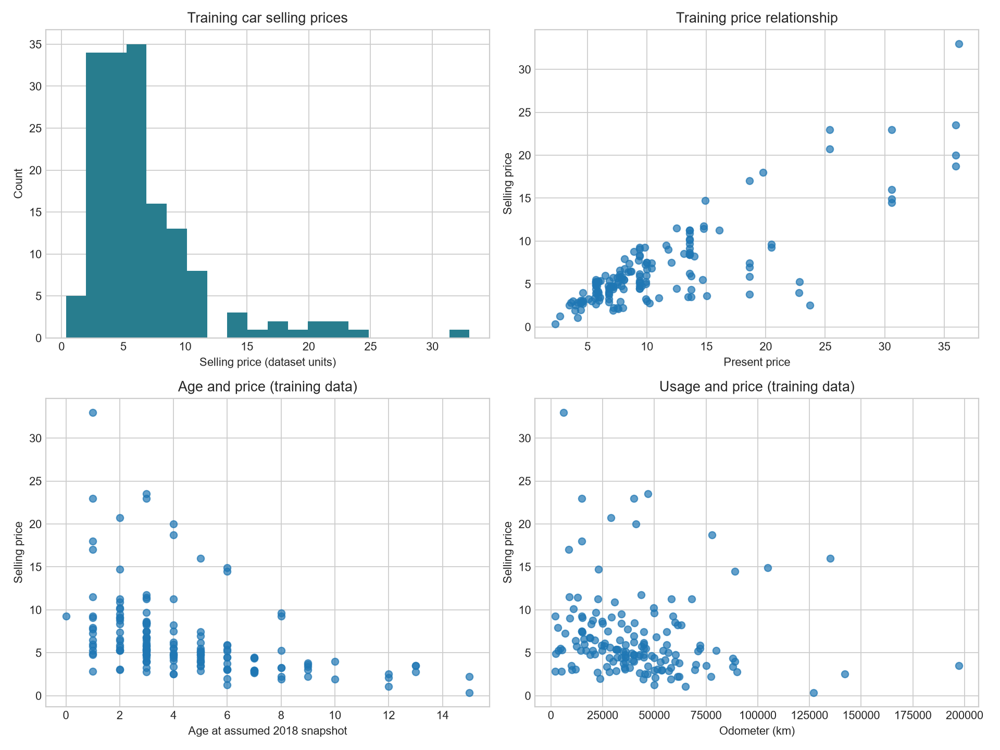
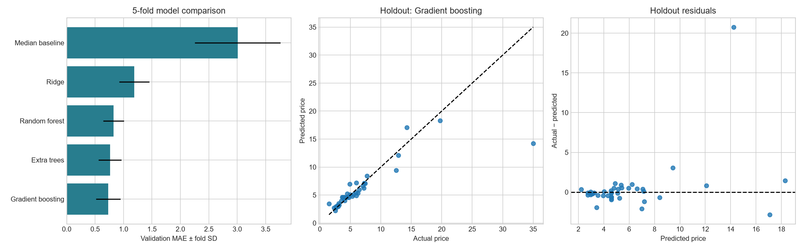
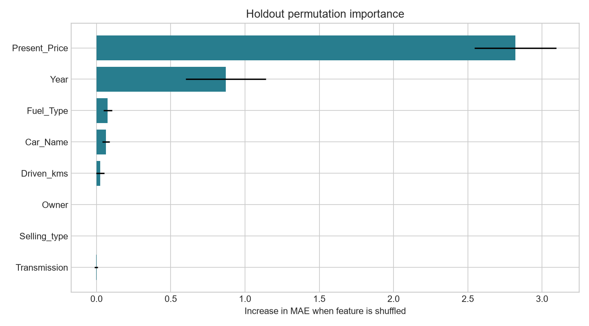

# Car price prediction — completed analysis

## Outcome

Gradient boosting was selected using training-set cross-validation. On the untouched 40-car holdout it achieved **MAE 1.198**, **RMSE 3.425**, and **R² 0.652**. The median baseline's MAE was **3.060**, so the model reduced mean absolute error by approximately **60.8%**. All prices and errors are in unverified dataset units.

## Model comparison

Five-fold cross-validation on 158 training cars, with seed 42:

| Model | Mean MAE | MAE fold SD | Mean RMSE | Mean R² |
| --- | ---: | ---: | ---: | ---: |
| Gradient boosting | 0.731 | 0.215 | 1.155 | 0.940 |
| Extra trees | 0.762 | 0.201 | 1.175 | 0.937 |
| Random forest | 0.822 | 0.182 | 1.307 | 0.922 |
| Ridge | 1.189 | 0.267 | 1.730 | 0.860 |
| Median baseline | 3.008 | 0.754 | 4.803 | -0.089 |

Selected configuration: gradient boosting with Huber loss, 200 estimators, depth 3, learning rate 0.05. Extra trees performed similarly in CV; the small sample does not establish that gradient boosting is universally superior.

## Error analysis

Training MAE was 0.229 versus holdout MAE 1.198, indicating a substantial generalization gap. One rare Land Cruiser had an actual price of 35.00 and prediction of 14.24, an absolute error of 20.76. This vehicle's price reference of 92.60 is extreme relative to the rest of the data. Tree models cannot reliably extrapolate to such rare luxury cases. This record remains in all reported holdout metrics; it was not discarded or used to retune the model.

Other large errors included an Innova (actual 12.50, predicted 9.44) and Corolla Altis (actual 14.25, predicted 17.09). RMSE being much larger than MAE reflects the influence of the rare large error. A 40-row holdout provides limited precision, particularly for luxury vehicles.

Present price had the largest permutation importance (MAE increase approximately 2.82), followed by manufacturing year (0.87). These shuffles propagate through feature engineering, so year importance includes age and annual mileage, while car-name importance includes derived brand. Correlated features and small samples make individual importance estimates uncertain. Near-zero importance does not prove a feature is irrelevant in broader markets, and negative importance can arise from noise.

## Task coverage

- **Data collection:** used the supplied archive, preserved the original, recorded its SHA-256 and audited excluded records.
- **Preprocessing:** normalized text, removed duplicates, filtered two-wheelers, validated ranges, implemented imputation, encoding and scaling within fitted pipelines.
- **Feature engineering:** brand, historical vehicle age, kilometres per year and log kilometres; absent horsepower/goodwill measures explicitly documented.
- **Regression:** compared four regression families against a median baseline, tuned on five-fold training CV and persisted the selected pipeline.
- **Evaluation:** held-out MAE, RMSE, R², residual plots, model comparison and permutation importance.
- **Application:** working batch prediction command, example input, executed notebook, documentation and automated preprocessing checks.

The example inputs produce estimates of approximately 5.04 for the Swift and 10.03 for the City. These are illustrative historical model estimates, not verified valuations.

The dataset has no accompanying provenance/license metadata. See the [README](README.md) for assumptions, reproducibility commands and the collection and validation work needed before practical use. Machine-readable results in [metrics.json](outputs/metrics.json) are authoritative for this run.
